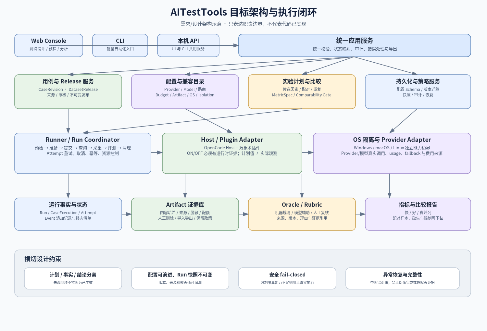
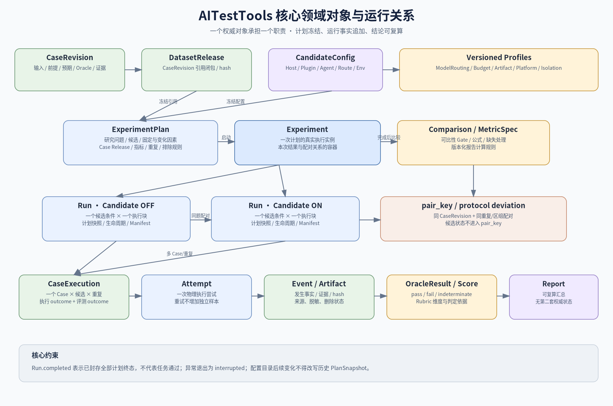
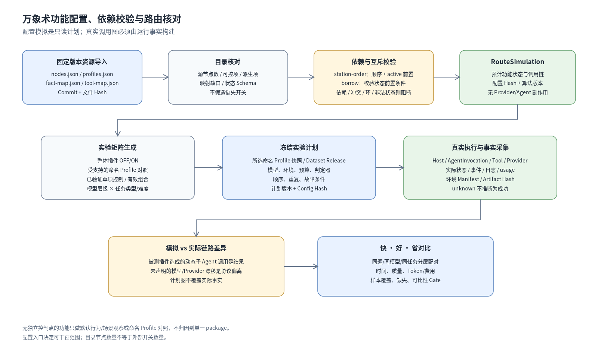
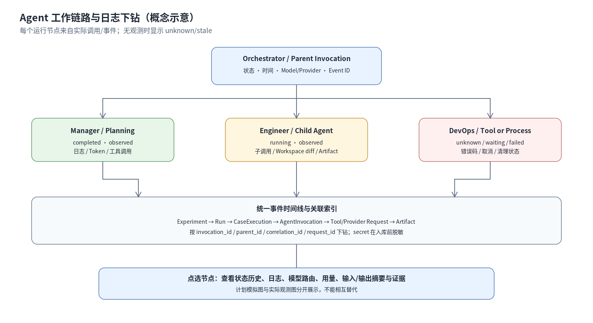
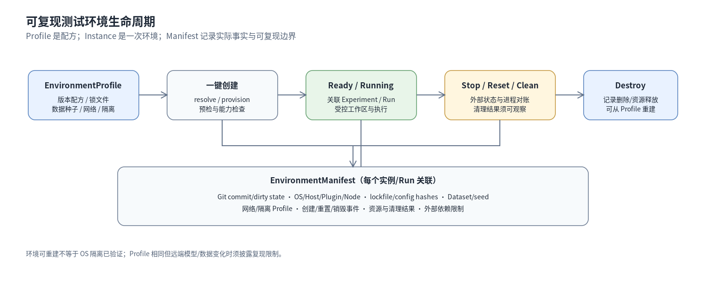

# AITestTools 总体架构与领域设计（V2.17）

**本文件是对象、状态、执行、证据、指标、Provider 和安全语义的唯一规范。** 产品功能需求见 `01_产品需求规格说明书.md`；UI 页面如何呈现见 `03_界面与交互设计.md`；首轮 ON/OFF 协议及“快、好、省”解释见 `04_首期实验方案与用例治理.md`。

## 1. 架构原则

1. **通用核心、被测对象专属适配。** AITestTools 提供 Case/Release、计划、执行、证据、评测、指标与报告能力；万象术专属开关、状态和证据由 `VibeFsAdapter` 解释，不把它们扩散为所有 Agent 都必须遵守的通用字段。
2. **同一概念只有一个权威对象。** Run 状态、逐 Case 结果、Attempt、实验重复、Oracle 结论及指标定义不可在多份表/文件中出现相互独立的权威副本。
3. **计划、事实、结论分离。** 执行前固定计划；运行时只追加可观察事实；终态时形成汇总。报告只能引用事实和已定义的计算，不能重写运行事实。
4. **未知即未知。** Host、Agent 或 Provider 无法提供的信息标为 `unknown/not_observed/unsupported`。不能用配置计划、模型自然语言或假默认值补出未观测事实。
5. **执行成功不等于任务成功，任务成功也不等于效果比较有效。** 执行状态、评测状态、归因和可比性是不同维度。
6. **先做可信的窄闭环，再做通用扩展。** 首期以模块化单体为宜，先打通用例版本、ON/OFF 对照、真实运行、证据和报告；不要为了未来所有 Provider 与 Agent 先建设复杂的分布式系统。
7. **安全能力必须有强制执行边界。** 独立目录或应用逻辑不是强沙箱。真实外部执行使用目标 OS 上能够强制执行权限边界的后端。
8. **消融配置要尊重源版本拓扑。** 功能目录、状态模式和依赖关系从固定的万象术版本导入；规划模拟不冒充真实执行轨迹。
9. **结果以黑盒证据判定，控制能力以真实配置契约判定。** 节点目录、默认行为与外部控制点是不同对象。不能从“有节点/有 Profile 状态”推断“有独立开关”，也不能从配置意图推断运行时效果。
10. **环境定义与环境实例分离。** Profile 描述如何建立环境，Manifest 记录实际建立结果与版本事实，才能支持弃用后重建和复现。

_图为目标架构概念图，不表示当前代码已经具备图中的全部能力。_

## 2. 逻辑组件和边界

| 组件                                                  | 职责                                                                                                  | 不应承担的职责                                                                             |
| ----------------------------------------------------- | ----------------------------------------------------------------------------------------------------- | ------------------------------------------------------------------------------------------ |
| Console / CLI / API                                   | 用户操作、参数校验、状态和证据展示                                                                    | 自行计算第二套业务结果或绕过应用服务调用 Runner                                            |
| Case / Dataset Service                                | Case 版本、标签、来源、审核、Release 冻结和查询                                                       | 把每个巡检站点自动生成正式 Case                                                            |
| Experiment Planner                                    | 候选配置、固定因素/变化因素、矩阵预览、预算估计、预检计划                                             | 开始执行后静默改变候选或排除标准                                                           |
| Runner / Scheduler                                    | 按冻结计划调度 CaseExecution/Attempt，管理超时、取消、重试和清理                                      | 把进程退出码直接当作业务通过                                                               |
| Host/Agent/Plugin Adapter                             | 对接真实 Host、插件、CLI 或远程 Agent，声明实际可观测能力                                             | 在通用核心中复制某个插件的业务实现                                                         |
| Provider Adapter / Model Catalog                      | Provider/部署目录、模型身份、usage、价格版本和调用结果                                                | 将用户选择的模型名称当作实际调用证据                                                       |
| Oracle / Rubric Service                               | 确定性判定、规则评分、模型辅助评分、人工复核                                                          | 把缺失证据强制转成通过/失败                                                                |
| Event / Artifact Store                                | 运行事件、证据产物、来源、哈希、脱敏和人工治理                                                        | 静默覆盖历史证据或把未知产物当成完整证据                                                   |
| Metric / Compare / Report                             | 依 MetricSpec 计算、执行可比性检查、生成可复算报告                                                    | 自动给出未经声明的总分、冠军或因果结论                                                     |
| OS Isolation Backend                                  | 将文件、命令、网络、资源、凭据和进程生命周期限制落实到 OS                                             | 仅凭应用层提示宣称隔离有效                                                                 |
| Feature Catalog / Control Registry / Ablation Planner | 导入万象术节点、默认行为与实际外部控制点；列出源 Profile、校验受支持的配置并生成受限实验矩阵/模拟路由 | 不能从目录自动造开关；不能将假设性状态作为可执行配置；不能把源节点数量等同于独立控制项数量 |
| Agent Trace Service                                   | 将 Host/Agent/工具/Provider 事件关联为实际调用图，提供状态与日志查询                                  | 不能用计划图或超时推断实际执行事实                                                         |
| Environment Manager                                   | 按 EnvironmentProfile 创建、校验、重置、销毁环境并生成 Manifest                                       | 不能把环境可重建误认为操作系统隔离已经验证                                                 |
| Fault Scenario Service                                | 管理受控故障注入、种子、预期状态及证据                                                                | 不向不受控的生产外部系统注入故障                                                           |

首期可使用模块化单体与本机存储。各组件通过明确的应用服务契约连接，避免 UI、CLI、报告各自解释状态或指标。Windows、macOS、Linux 均为首期目标平台；正式首期发布前，每个 OS 至少要有一个经验证的版本组合完成本机控制台、用例/配置管理、真实 Agent/插件任务执行、证据采集与结果查看的核心闭环。每个后续正式声明支持的组合也必须具备独立证据。真实执行仅在对应组合具备经验证的强制隔离后端时开放；未验证组合可进入评估状态，但不能仅凭控制台启动就声明为完整支持。

## 3. 唯一领域对象模型

### 3.1 规范对象

| 对象                                          | 含义与职责                                                                                                                                                                                   | 版本/关联要求                                                                                                                                                                                                                      |
| --------------------------------------------- | -------------------------------------------------------------------------------------------------------------------------------------------------------------------------------------------- | ---------------------------------------------------------------------------------------------------------------------------------------------------------------------------------------------------------------------------------- |
| `Case`                                        | 稳定的逻辑用例身份/系列；用于承载同一测试意图在不同版本间的关系                                                                                                                              | 稳定 `case_id`；不在该父对象上原地改写已发布内容                                                                                                                                                                                   |
| `CaseRevision`                                | 某个 Case 在一个修订号下的不可变规格正文：输入、前提、步骤/动作、预期、Oracle/Rubric、证据、设置/清理、标签、风险和来源                                                                      | 有唯一 `case_revision_id`、修订号与内容 hash；修改内容创建新修订；正式 Release 只引用确切修订                                                                                                                                      |
| `DatasetRelease`                              | 用于某一类运行的冻结案例集合及其完整引用闭包                                                                                                                                                 | 不可变；逐项引用 `CaseRevision`、材料、Oracle/Rubric 和相关配置的版本/hash，可验证并恢复完整引用闭包                                                                                                                               |
| `SuitePlan` / `RouteStep`                     | 将 DatasetRelease 中的用例按依赖、顺序、前置条件和失败后的继续/停止策略组成执行路线                                                                                                          | 只定义路线、步骤级引用和步骤级证据要求；不拥有 Run/Experiment 级预算、并发、重试、计时口径或评分器的第二份权威值                                                                                                                   |
| `ExperimentPlan`                              | 一次实验的目标问题、候选配置、固定条件、变化因素、指标、重复与比较协议，并拥有本次实验共享的 Run 级时间/调用/Token/费用/资源预算、并发、重试、计时/采集、顺序、ArtifactPolicy 引用及清理协议 | 执行前冻结为计划版本；各候选引用同一份共享协议，只有预先声明为实验因素的配置可按候选变化；修改协议应创建新版本/新计划                                                                                                              |
| `Experiment`                                  | 一个冻结 `ExperimentPlan` 的一次真实执行实例；关联本次各候选条件及其 Run                                                                                                                     | 每次重跑使用新 Experiment ID；负责形成 ON/OFF 或其他候选之间的配对关系                                                                                                                                                             |
| `CandidateConfig`                             | 一个待测系统候选的版本化配置组合                                                                                                                                                             | 包含 Host/Agent/插件版本、计划模型路由策略、`FeatureAblationProfile`、环境/权限和明确允许作为候选差异的配置引用；实验共享的 DatasetRelease、Oracle/Rubric、MetricSpec、重复/顺序协议由 `ExperimentPlan` 唯一定义，避免两份权威副本 |
| `FeatureCatalogRelease`                       | 固定插件版本对应的 package/slice 节点、来源、关系和默认行为证据的不可变目录快照                                                                                                              | 记录源 commit/package hash、nodes/profiles/fact-map/tool-map 来源及 hash、schema 版本和映射对账；节点数、外部控制点数和可单独干预项数分开统计                                                                                      |
| `FeatureControlPoint`                         | 被测版本实际支持的外部配置入口，例如明确的环境变量、配置字段或命名 Profile 选择入口                                                                                                          | 记录接口、默认值来源、允许值、适用版本、生效证据和可变范围；不存在的接口不得按节点名推造                                                                                                                                           |
| `FeatureAblationProfile`                      | 被测版本的源定义命名 Profile，或经证明被实际运行入口接受的配置快照                                                                                                                           | 记录每个节点在该 Profile 下的源状态；Profile 中有节点状态不等于该节点可被外部独立覆盖；自定义 Profile 必须保存如何被运行时接受的证据                                                                                               |
| `FeatureInterventionPlan`                     | 实验中对一个或多个真实控制点/可选 Profile 进行干预的计划，或声明为仅观察的测试计划                                                                                                           | 区分 `plugin_on_off`、`select_named_profile`、`single_control_point`、`profile_compare`、`scenario_observation`、`source_assisted_variant`；记录固定变量、控制证据和归因范围                                                       |
| `RouteSimulation`                             | 对已选择 Profile 或候选干预计算的只读路由计划                                                                                                                                                | 记录输入 config hash、算法版本、拓扑顺序、预计节点/角色链路、警告和阻断原因；分别标记“运行时可执行候选”与“假设性模拟”；不是实际 AgentInvocation                                                                                    |
| `EnvironmentProfile`                          | 一键创建/重置测试环境的版本化配方                                                                                                                                                            | 描述 OS/运行时/Host/插件、锁文件、工作区模板、数据种子、网络策略、外部状态重置和隔离 Profile 引用                                                                                                                                  |
| `EnvironmentInstance` / `EnvironmentManifest` | 一次真实环境实例及其实际状态/版本/清理证据                                                                                                                                                   | 与 Run 关联；Manifest 记录计划和实际版本、Git commit/dirty 状态、hash、创建/重置/销毁事件及不确定项                                                                                                                                |
| `Run`                                         | 一个 Experiment 中某候选/条件在一个预先声明执行块（含其 Case 集合）的批次执行                                                                                                                | 仅保存对 ExperimentPlan 级预算/执行协议的引用及执行事实；不得复制一份可独立编辑的权威预算或指标配置。候选有多个独立重复块时可有多个 Run；汇总结果由子项派生                                                                        |
| `CaseExecution`                               | 一个精确 `CaseRevision` 在某个候选、区组/重复编号下的单次计划观测                                                                                                                            | 必须引用 `case_revision_id`；拥有该次执行 outcome 与 evaluation outcome                                                                                                                                                            |
| `Attempt`                                     | 对一个 CaseExecution 的一次物理执行尝试                                                                                                                                                      | 每次技术重试创建新 Attempt；Attempt 数不能当作独立样本数                                                                                                                                                                           |
| `AgentInvocation`                             | 一次实际 Agent/角色调用的关联实体，用于表示父子调用和状态变化                                                                                                                                | 从可观察的 Host/Agent 事件派生或由 Adapter 明确提交；记录 parent/child、invocation ID、模型/Provider（可观测时）、时间、状态、消耗和证据引用；未知字段保持未知                                                                     |
| `Event`                                       | 实际发生的阶段迁移、工具调用、Provider 调用、错误、取消和清理等                                                                                                                              | 追加式记录，按时间/序号和关联 ID 查询；工作链路视图由事件/调用数据派生，不另建独立事实源                                                                                                                                           |
| `FaultInjectionProfile` / `FaultScenario`     | 对受控网络、Provider、Host、环境、持久化、评测和清理异常的版本化定义                                                                                                                         | 必须定义注入范围、种子、预期状态/副作用和证据；默认只允许在隔离环境或 Stub/代理下执行                                                                                                                                              |
| `Artifact`                                    | 日志、输出、截图、diff、文件、trace 等实际证据                                                                                                                                               | 记录来源、内容哈希、类别、脱敏状态、大小和删除状态                                                                                                                                                                                 |
| `OracleResult` / `Score`                      | 对 CaseExecution 的机器判定、Rubric 评分或人工评价                                                                                                                                           | 引用所用规则/评分器版本、理由及证据                                                                                                                                                                                                |
| `MetricSpec`                                  | 指标的定义、公式、单位、作用范围、数据来源、分母/缺失和聚合规则                                                                                                                              | 版本化；历史报告必须引用原版本                                                                                                                                                                                                     |
| `Comparison`                                  | 按冻结协议对候选进行配对和比较的结果                                                                                                                                                         | 保存可比性 Gate、配对关系、偏离、缺失、公式和报告版本                                                                                                                                                                              |

### 3.2 与当前题库资产的关系

§3.1 的领域对象是**唯一权威模型**。现有 AITestTools 资产（Item、Material、Paperset、Room）是 V1 阶段的物理存储形态，在 V2.17 重构中**迁移为领域对象**，不保留两套并行口径。概念关系按以下原则处理：

- `Item` 承载的现有内容迁移为 `Case`（逻辑身份）+ `CaseRevision`（不可变修订正文）。迁移后 `ItemDoc` 类型与 `*.item.json` 资产协议**不再作为权威模型**；`CaseRevision` 通过 `case_id` + `case_revision_id` + 内容 hash 表达不可变修订。现有 `rev` 字段语义并入 `case_revision_id`。
- `Paperset` 迁移为 `DatasetRelease`（冻结的 CaseRevision 引用闭包）。Release 逐项冻结 `CaseRevision` 及整个引用闭包，包括材料、评测规则与关联文件的实际版本/hash，确保历史输入可恢复。
- `Room` 迁移为 `EnvironmentProfile` / `CandidateConfig` 的物理来源，不自动替代 CandidateConfig 或计划快照。
- 现有 159 对人题（318 个 `*.item.json`）通过一次性迁移脚本转为 Case/CaseRevision 资产；迁移保证 OFF/ON 配对关系（`pair_key`）、`hosted_pass_token`、Oracle 判定规则语义等价，历史 run 产物仍可被 compare 读取。
- 保存 hash 只能验证内容是否一致，不能取代可恢复的内容、版本和引用关系。

Case 的正式生命周期与自动化准备度是两个正交维度。自动化准备度至少包括 `not_assessed / manual_only / spec_incomplete / design_ready / blocked`；不要因为 Case 已发布就推断已有可运行脚本，也不要因为脚本存在就推断其预期合同经过审核。准备度判断参考前置条件、步骤/动作、输入数据、明确预期、Oracle/Rubric、证据需求、初始化/清理、权限/副作用和依赖是否齐全。自动化准备度只表示设计是否适合进入自动化，不代表该 Case 已有可执行脚本或在某次 Run 中通过。

人工巡检路线是只读来源或执行指南，不自动是一套需求库，也不是 Case 状态账本。仅当某项行为合同经过确认、可定义预期且值得自动化时，才建立需求与 Case 的显式关联。

### 3.3 对象关系与所有权

一个 `ExperimentPlan` 声明候选、冻结数据与协议；每次启动产生一个 `Experiment` 实例。Experiment 按候选条件与重复/区组策略生成一个或多个 Run。每个 Run 对应一个候选条件和一个预先声明的执行块，可包含该块内所有 Case；每个 `CaseExecution` 必须引用确切的 `CaseRevision`、Run、候选和独立重复序号，可关联零个或多个 Attempt：预检阻断、取消前未启动或 `not_run` 的项目允许零个；已经执行的项目至少关联一个 Attempt。ON/OFF 同一 CaseRevision、同一重复序号/区组的执行共享 `pair_key`，该 key 不包含候选状态本身；同一实验里的不同 Case 或重复不能误配。每个 Attempt/Event/Artifact/OracleResult 都用稳定 ID 与来源相连。Run/Experiment 的汇总值是由子项派生的缓存/报告，不另设可人工写入的权威业务结果。

不再建立一个独立且具权威性的 `Replicate` 结果实体。统计重复以新 `CaseExecution` + `replicate_index` 表达；技术重试只创建 Attempt。

### 3.4 权威状态字段

| 字段                   | 所属对象               | 允许值/规则                                                                                                                                                                            |
| ---------------------- | ---------------------- | -------------------------------------------------------------------------------------------------------------------------------------------------------------------------------------- |
| `run_lifecycle_status` | Run                    | `created / preflight / queued / running / cancelling / completed / failed / cancelled / blocked / interrupted`（`interrupted` 表示异常退出后仍待对账，不是成功终态）                   |
| `execution_outcome`    | CaseExecution          | `completed / execution_failed / blocked / cancelled / timed_out / not_run / unknown`                                                                                                   |
| `evaluation_outcome`   | CaseExecution          | `pass / fail / indeterminate / not_evaluated`                                                                                                                                          |
| `attempt_status`       | Attempt                | `created / starting / running / completed / failed / cancelled / timed_out / interrupted / unknown`；不使用 `blocked` 或 `not_run` 表示从未执行的计划项                                |
| `attribution_tags`     | CaseExecution / Run 等 | `product_defect / environment_failure / provider_error / test_data_issue / expected_negative_behavior / flaky_or_nondeterministic / design_pending / unknown` 等分类；不能取代 outcome |

Run 状态机允许的主要转换如下；除表内转换外一律拒绝并记录原因：

| 当前状态                                   | 允许的后继状态                                          | 条件/说明                                                                                                                                                         |
| ------------------------------------------ | ------------------------------------------------------- | ----------------------------------------------------------------------------------------------------------------------------------------------------------------- |
| `created`                                  | `preflight / blocked / failed / interrupted`            | 进入预检，或在执行前明确阻断/失败；进程退出后缺少终态清单时由恢复流程标记中断                                                                                     |
| `preflight`                                | `queued / running / blocked / failed / interrupted`     | 仅预检满足要求后可进入调度/执行                                                                                                                                   |
| `queued`                                   | `running / cancelling / blocked / failed / interrupted` | 调度启动、取消或明确阻断/失败                                                                                                                                     |
| `running`                                  | `cancelling / completed / failed / interrupted`         | 完成、请求取消、编排失败或异常退出                                                                                                                                |
| `cancelling`                               | `cancelled / completed / failed / interrupted`          | 通常在取消/清理后转 `cancelled`；若取消请求到达时所有计划项已按协议完成，则可封存为 `completed`                                                                   |
| `interrupted`                              | `running / completed / failed / cancelled / blocked`    | 必须先执行对账；只有确认外部副作用状态并证明后续动作可安全执行时，才允许通过显式恢复事件转回 `running` 并创建新 Attempt；否则只能封存为可证实的终态或继续保持中断 |
| `completed / failed / cancelled / blocked` | 无                                                      | 终态不可原地重开；需要再次执行时创建新的 Experiment/Run，并链接原记录                                                                                             |

语义边界必须明确：`Run.completed` 表示编排按计划正常走到终点、所有计划项均获得明确终态（包括 Case 失败、阻断、未运行等）、清理结果已记录且终态清单已封存；它不表示所有任务通过。`Run.failed` 表示编排/持久化等错误导致本次 Run 未能按正常协议完成；系统应尽力封存失败清单，若宿主进程消失且无法可靠封存，则先记为 `interrupted` 并等待对账。`Run.interrupted` 是未对账状态，不能用于正式效果比较；对账后可转入明确终态，原中断事件仍保留。`Run.cancelled` 只在用户取消已被处理、各计划项的取消/未运行状态和清理结果均已记入且终态清单封存后使用。Run 状态转换必须受显式状态机约束：`created → preflight → queued/running`，各阶段只能转入定义的后继状态或明确终态；`interrupted` 只能在对账后转入已证实的终态，或在确认可安全续跑、外部副作用已对账且创建新 Attempt/恢复事件后转回 `running`。无法确认外部副作用是否发生时不得续跑；需重新开始的实验应创建新的 Experiment/Run 并链接原记录。非法状态跳转应被拒绝并留存原因。`CaseExecution.execution_outcome=completed` 表示该次执行流程已到达可评测终点，不表示任务满足要求；`evaluation_outcome=pass` 才表示该 Case 按预先声明的合同通过。若 Agent 正常返回了错误答案，通常应记录执行完成、评测失败，而不是把它误记为 Runner 执行失败。`RunSummary` 只能汇总数量与指标，不得建立另一个权威 `execution_status` 或 `evaluation_status`。UI 可以把多个字段合成易懂文案，但必须依据确定性映射，并保留各字段的技术明细。

### 3.5 三段式运行记录

运行记录逻辑上包含三段：

1. **`RunPlanSnapshot`：** 在任何执行副作用前冻结，存储输入/版本、候选、解析配置、预算、权限、指标、重复/顺序策略、预检结果和清理策略。
2. **`ObservedFacts` / Event / Artifact：** 随执行追加，记录真实 Host 插件状态、实际模型调用、时间、工具调用、消耗、退出码、异常、证据和清理结果。
3. **`RunFinalManifest`：** 终态后引用计划快照和执行事实，汇总各子项终态、哈希及报告引用；进程崩溃时可以缺失，不能反向伪造或覆写已冻结计划。

计划中的值、Adapter/Provider 解析出来的值、运行中实际观测到的值分别标为 `planned`、`resolved`、`observed`。例如界面选择“模型 A”只证明计划值；若 Host 未提供调用记录，则实际模型应显示未知。

## 4. Adapter、Runner 与 Provider 合同

### 4.1 Host/Agent/Plugin 适配能力

首期需要以能力声明方式接入 OpenCode + 万象术；未来可扩展插件型 Host、独立 CLI Agent 或 API Agent。Adapter 至少声明：

- 被测对象、Host 和版本的发现/固定方式；
- 插件加载/未加载如何被证实，开关是否可以独立控制；
- 任务提交、状态查询、输出收集、超时/取消和清理能力；
- 可采集的事件、工具调用、工作区变更、模型调用和 usage 字段；
- 文件、命令、网络、进程和凭据等权限/隔离支持；
- 不可观测字段与不支持能力。

可观测性应逐字段表达，避免简单给 Adapter 一个“全支持”的总标签。能力声明是接口契约，仍需由实际运行行为证据支撑。

### 4.2 统一执行阶段

Runner 与 Adapter 的交互应表达为：`discover/resolve → preflight → prepare → submit/start → query/status → collect → evaluate → cleanup`。具体适配器可将相邻阶段合并，但必须能报告发生了什么、失败在哪一步以及是否完成清理。

错误输出使用稳定错误类别、关联 ID、简明原因与是否可安全重试的建议。原始堆栈、绝对路径、凭据或完整环境变量不应返回给普通客户端。Runner 不得在调用结果不明确时盲目重试产生外部副作用的请求。

### 4.3 多 Provider 与模型资源池

`Provider` 标识服务提供方；`Deployment` 表示实际部署/区域/端点；`ModelRef` 是可稳定识别的模型/部署标识；`ModelCapability` 表达有来源的能力事实；`AgentRoleRequirement` 描述具体角色的必需/可选能力；`ModelRoutingProfile` 是不可变版本的实际候选路由规则。

一条路由至少关联 `agent_id / role_id / provider_id / model_id / deployment_id / parameter_profile / fallback_policy / route_policy_version`。路由可以让同一模型服务多个角色，也可以在不同候选之间切换某个角色。`target_model` 和 `judge_model` 是不同的调用角色，必须分别计量与报告。

能力匹配结果为 `compatible / partially_compatible / incompatible / unverified`，并附理由和证据来源。不能因模型名包含“code”或“reasoning”就推断具备某能力；供应商声明和真实探针结果必须区分。Fallback 链一旦生效，记录真实调用路径，费用与 Token 归到对应角色和整个 CaseExecution。

### 4.4 Provider usage 和成本

每次调用在能获取时记录 Provider、Model/Deployment、角色、请求 ID、开始/结束时间、input/output/total tokens、错误、fallback 来源、费用来源与价格版本。usage 可能来自 Provider 实际返回、Host/Runner 计量或估算，必须标记来源和置信边界。

实际账单、按价格表估算的费用和未知费用分列。没有 Token usage 时不能用字符数推测出的值冒充 Provider 真实 Token；可以另外提供带“估算”标签的值。模型调用、评分器调用和工具/基础设施成本分开统计，避免把评测自身的成本归入被测任务却不披露。运行预算的默认口径为被测任务路径，累计所有子 Agent/角色、Provider 路由、fallback 和技术重试；评分器/观察器消耗单独计量，若需纳入总 Run 预算必须在 Plan 中显式声明。

### 4.5 功能消融目录、依赖验证与模拟路由

固定参考版本的源文件为 [nodes.json](https://raw.githubusercontent.com/PamelaSprin47685ghall/vibe-fs/6030d14c4404d79c9e61e4018d59075be4de48a9/resources/ablation/nodes.json)、[profiles.json](https://raw.githubusercontent.com/PamelaSprin47685ghall/vibe-fs/6030d14c4404d79c9e61e4018d59075be4de48a9/resources/ablation/profiles.json)、[fact-map.json](https://raw.githubusercontent.com/PamelaSprin47685ghall/vibe-fs/6030d14c4404d79c9e61e4018d59075be4de48a9/resources/ablation/fact-map.json)、[tool-map.json](https://raw.githubusercontent.com/PamelaSprin47685ghall/vibe-fs/6030d14c4404d79c9e61e4018d59075be4de48a9/resources/ablation/tool-map.json)，并需结合[固定版本 README](https://github.com/PamelaSprin47685ghall/vibe-fs/blob/6030d14c4404d79c9e61e4018d59075be4de48a9/README.md)、同一 commit 的 `requirements/` 清单和相关实现核验。 状态与边的实际校验需同时核对 [Manifest.fs](https://raw.githubusercontent.com/PamelaSprin47685ghall/vibe-fs/6030d14c4404d79c9e61e4018d59075be4de48a9/src/Wanxiangshu/Ablation/Manifest.fs) 和 [ablation-manifest.mjs](https://raw.githubusercontent.com/PamelaSprin47685ghall/vibe-fs/6030d14c4404d79c9e61e4018d59075be4de48a9/scripts/checks/ablation-manifest.mjs)；`parent` 是节点属性，不是可替代源边的边类型。该 `nodes.json` 基线包含 56 个 `kind=package` 节点和 3 个 `kind=slice` 节点；“56”是 package 计数，不等于 56 个可独立改变的布尔开关。源文件、commit、hash、导入器版本和核对结果必须随不可变 `FeatureCatalogRelease` 保存。

#### 4.5.1 目录节点、默认行为和外部控制点是三种不同信息

该固定版本 README 把 `WANXIANGSHU_ABLATION_PROFILE` 公开为命名消融 Profile 的选择入口；`profiles.json` 存储这些 Profile 的节点状态组合。运行时选择一个已有 Profile，是**配置组合级控制**；这并不自动提供对每个 package 的**独立外部开关**。`Manifest.fs` 中的状态映射/验证逻辑说明了哪些状态在拓扑上合法，但只有当实际运行入口接受某个候选配置，并且执行证据显示它生效时，才可把它登记为可用干预。

默认行为应按以下流程定义：如果用户没有提供外部控制值，则记录目标版本在该入口下解析出来的实际默认行为/默认 Profile；系统不自行发明默认参数。若该行为只能从代码/随包资源确定，标记来源类型为“版本内置/资源默认”，并记录被测 commit 与资源 hash。黑盒结果判断仍基于任务产物、预期合同、Oracle/Rubric、实际耗时和 usage；源目录仅用于识别测试范围与合法配置边界，不作为任务质量的替代证据。

每个目录节点必须分类其当前可行测试方式：

| 控制能力                                 | 产品行为                                  | 可支持的结论                                          |
| ---------------------------------------- | ----------------------------------------- | ----------------------------------------------------- |
| 有受支持的独立外部控制点                 | 可进行单项干预，校验实际生效              | 满足其他固定条件时，可报告该干预的配对差异            |
| 仅有公开的命名 Profile 选择              | 只能选择已存在 Profile，比较整个配置组合  | 归因到 Profile/配置组合，不归因到其中某个单独 package |
| 只有场景触发/可观测行为                  | 不提供开关；用例触发相关行为并采集证据    | 报告场景覆盖和行为表现，不作独立开关因果结论          |
| 需要修改随包 Profile、资源或源码才可改变 | 标记源辅助变体，固定新 commit/hash 与构建 | 与原版黑盒结果分开报告，说明变体改变了什么            |
| 控制能力或生效证据未知                   | 禁止发布为可执行单项实验                  | 只能标记待核验或观察项                                |

因此，功能目录的目标是完整呈现源节点和关系，不是将所有节点渲染为可编辑控件。任何 UI “启用/禁用”操作都必须绑定到真实控制点；没有控制点时应显示默认行为、观测方法和限制。

节点状态应依据源 Schema 表达。该版本的 `profiles.json` 使用 `active / borrowed / ablated` 等状态值，界面和导出必须保留三态语义，不能简化成会改变行为含义的布尔开关。源关系中必须分别保留 `station-order` 与 `borrow`：两者都参与 DAG 环检测与 Profile 合法性校验，但触发条件不同。固定版本的校验契约规定：对 `station-order` 边，只有当 `to=active` 时才要求 `from` 为 `active` 或 `borrowed`；对 `borrow` 边，当 `to=borrowed` 或 `to=active` 时，要求 `from` 为 `active` 或 `borrowed`。这不是把任一源边改造成通用业务硬依赖，而是保留源校验器的状态转换条件。实现以固定 commit 的 Profile 校验器和实际配置契约为准，并以契约测试锁定边界语义，不能仅根据边名猜测。若节点不能独立变更，配置界面应将其设为只读、派生或“仅可观测”。节点至少包含 `node_id`、`node_kind`、源 `station`、父/子节点、源边及类型、顺序前驱、借用前置节点、经证实的硬依赖、冲突/交互关系、源 `requirements/` 路径映射、状态模式、配置 Schema、来源、控制能力、观测方法和验证状态。

校验流程：导入固定源文件 → Schema/源版本校验 → 节点 ID 与引用一致性检查 → 对同一 commit 的源节点、Profile、`requirements/` 清单和实现做映射对账 → 保留并分类所有源边（至少识别该版本的 `station-order` 与 `borrow`，未知类型保留并标记待判定）→ 校验借用状态前置条件及经证实的硬依赖/互斥 → 环检测 → 依据已验证约束生成稳定、可复现的拓扑/解除消融顺序（`station` 有重复或缺号时，用源边与稳定 `node_id` 等规则消歧）→ 生成候选配置 → 模拟路由 → 冻结 `FeatureAblationProfile`。`station-order` 不能自动升级为硬依赖；`borrow` 不能降格为普通排序；通用硬依赖必须有源 Schema、Profile 或实际实现证据。映射缺项、借用前置条件违反、缺失硬依赖、非法状态、未知边类型、互斥冲突或不可独立控制的节点被误设为独立变量时，需阻断相关 Profile/实验或明确转为经说明的组合/观察测试。

`RouteSimulation` 是纯计算、无副作用的规划结果，只能呈现“预计/模拟”。输入必须标明来自可选择的源 Profile、经验证的外部控制点还是纯假设性状态。只有运行时接口真实接受且控制能力经过验证的候选，才标记为“可执行候选”；其他状态组合只能标记为“假设性模拟/不可直接执行”。模拟不能调用真实 Provider、启动 Agent、写目标工作区或声称插件已经实际激活。真实运行开始后，`AgentInvocation`、Event 和 Host 证据构成实际链路，再与模拟图做结构差异比较；不能由模拟结果反推实际事实。

### 4.6 Agent 实际调用链与工作流日志

Agent 身份/角色定义与 `AgentInvocation` 实际调用记录必须分开。`AgentInvocation` 具有 invocation ID、父调用 ID、Experiment/Run/CaseExecution 关联、Agent/角色、planned/resolved/observed 路由、状态、起止时间、工具/子调用引用、Token/费用观测、错误与 Artifact 关联。可观察状态至少覆盖 queued、running、waiting、completed、failed、cancelled、blocked、interrupted、unknown；Adapter 可额外细化，但不能把未知映射成成功或运行中。

工作链路图是由调用记录和追加式 Event 派生的查询视图。每个节点可下钻日志、请求/关联 ID、模型路由、Token/费用、产物和父子关系。实时性取决于 Host/Adapter 的观测能力；缺少心跳或事件时展示 `unknown/stale` 和最近观测时间，不根据超时单方面推断 Agent 已死亡。模拟路由与实际执行图需要显著区分。

### 4.7 可复现环境生命周期

`EnvironmentProfile` 定义可复用环境配方，生命周期为 `draft → active → deprecated`；弃用意味着不再用于新 Run，但不删除历史引用，也不妨碍按原版本复现。`EnvironmentInstance` 表示一次实际实例，`EnvironmentManifest` 保存创建事实。实例生命周期为 `not_created → resolving → provisioning → validating → ready → running → stopping → cleaned/destroyed`，并支持 `failed/dirty/cleanup_failed` 等异常状态。销毁实例与弃用 Profile 是不同操作。创建、重置、销毁都需要幂等或明确重试边界，并记录输入版本、输出资源 ID、开始/结束时间和清理结果。

环境复现清单应包含 OS/架构、Host/万象术/Node/包管理器版本、lockfile 与依赖摘要、测试平台 Git commit 和 dirty 状态、环境变量允许清单、Secret Reference（不含秘密值）、数据/随机种子、工作区与外部状态初始化/清理规则、网络配置、预算、隔离 Profile 和创建/重置脚本版本。一键重建以相同 Profile 和受控输入生成新实例；对 Provider 端模型漂移、远程数据更新或无法固定的外部服务，应记录限制，而不是承诺绝对可复现。

测试环境负责版本、工作区、依赖和测试数据状态的隔离/重建；`IsolationBackend` 负责对真实执行进行 OS 级权限边界强制。二者可以联动，但不能互相替代。

### 4.8 故障注入和非功能场景模型

`FaultInjectionProfile` 将故障按阶段和层次编排，最低覆盖环境解析/创建、Host 与插件加载、功能目录校验与路由模拟、Agent/子 Agent 调用、Provider 网络请求、工具执行、证据采集、Artifact 写入、Oracle/Rubric 评测、持久化/RunFinalManifest、取消和清理。网络场景至少包含 DNS 失败、连接超时、请求提交后断连、429/限流、5xx、慢响应/响应中断、usage 不可用等。

每个 Scenario 固定故障类型、触发点、概率/持续期（如需）、随机种子、恢复策略、最大次数、期望 Run/Case/Attempt 状态、预算影响、副作用对账要求、证据要求与清理结果。请求已提交但响应丢失时，若无法通过 request ID/Host 状态/幂等键确认是否已执行，则标为 unknown 并阻止盲目重放。故障注入默认在 Stub、受控代理或隔离测试环境中执行；不得对无授权的生产服务或公共网络施加破坏性故障。测试平台自身的失败同样需要事件和可恢复状态，不能把“异常测试没有跑完”当作被测对象失败。

## 5. 评测与指标契约

### 5.1 Oracle / Rubric 结果

机器 Oracle 的单项结果为 `pass / fail / indeterminate`，并带规则版本、理由和证据引用。缺证据、测试前提未满足或规则无法判定时不能默默通过。Rubric 评分需说明维度、量表、权重、评分者/模型、Prompt/模型版本及适用条件。确定性规则、模型裁判和人工评分是不同来源，不允许混为一个未经解释的分数。

### 5.2 MetricSpec 最小定义

每个指标至少有：`metric_id`、展示名、业务含义、公式或聚合方法、单位、作用范围（Case/Attempt/Run/Experiment）、分子/分母、数据源/来源版本、适用条件、方向（越高越好/越低越好/中性）、缺失值规则、排除规则、可否用于 Gate、比较前提和指标版本。

报告必须区分至少两种通过率：

- `planned_success_yield = pass_count / predeclared_in_scope_case_execution_count`：纳入计划范围的整体成功产出率。计划中阻塞、未运行、取消、超时、执行失败和无法判定的项目不能从分母中静默移除。
- `evaluated_pass_rate = pass_count / (pass_count + fail_count)`：只在已确定判为 pass/fail 的项目中计算，不能被解释为完整计划任务的成功概率。

此外单独报告计划项、启动项、终态项、已判定项、`indeterminate`、`not_evaluated`、`blocked`、`not_run`、`cancelled`、`timed_out`、`unknown` 和协议排除项。

### 5.3 比较前的可比性 Gate

Gate 必须针对本次要支持的结论，而不是一个泛化布尔值。至少检查：

- 相同冻结 Case/Dataset/材料与 Oracle/Rubric 版本；
- 预声明的固定因素与唯一/指定变化因素；
- Host/Agent/插件状态及版本证据、预先冻结的模型路由策略和允许的 fallback 规则；
- 相同权限、预算、并发、缓存/预热、工作区/会话重置、顺序和清理策略；
- 相同计时边界、采集器与计量来源；
- 配对 Case、重复数、缺失数据、排除规则和协议偏离完整可见。

Gate 结果至少表达 `eligible / eligible_with_limitations / exploratory_only / blocked`。未通过时仍可展示原始结果和差异原因，但不输出正式效果提升、冠军或因果归因。比较时必须区分**计划条件偏离**与**运行中观测到的实际行为差异**：同一个预先冻结的路由策略可能因万象术 ON/OFF 而调用不同数量/路径的子 Agent 或角色；若这是被测系统行为，不自动判为不可比，而应作为机制/成本结果记录。只有未声明的配置漂移、超出计划允许范围的 fallback、候选实际身份无法确认且结论依赖该身份，才触发相应范围的 Gate 降级或阻断。实际条件偏离计划后，不能回看结果再随意选取排除规则。

### 5.4 重试、顺序和观测开销

技术重试需要有错误分类、最大次数、退避、预算和幂等条件。若 Host 是否接受请求或是否产生副作用不确定，优先查询/对账或使用幂等键；没有安全依据时停止自动重放，标明 `unknown` 并请求人工处理。

正式比较要冻结候选顺序/seed、缓存/预热、并发、外部状态重置、工作区和清理规则。条件允许时采用配对、随机或平衡顺序；无法做到时报告可能的顺序效应。观测器与清理开销需和目标任务耗时分开，以免将采集成本误认为插件性能。

## 6. 配置、注册表、Schema 与历史记录

配置值与架构决策要分开。实际 Case 内容/预期、Provider/Deployment/Model 条目、模型路由、BudgetProfile、ArtifactPolicy、OS 版本范围、隔离后端选项都是可维护的配置记录；产品需求不应把某个具体清单或数值写成唯一固定方案。架构负责提供可扩展的配置对象、Schema、校验、版本、解析、审计和兼容迁移机制。

核心配置对象至少包括：

| 配置对象                                                            | 主要内容                                                                               | 生效规则                                                                                                          |
| ------------------------------------------------------------------- | -------------------------------------------------------------------------------------- | ----------------------------------------------------------------------------------------------------------------- |
| `CaseRevision` / `DatasetRelease`                                   | 任务输入、预期、Oracle/Rubric、证据要求和用例集合                                      | 内容按用例工作流维护；正式比较选定并冻结 DatasetRelease。                                                         |
| `ProviderDefinition` / `DeploymentDefinition` / `ModelCatalogEntry` | Provider Adapter、端点/部署标识、模型能力、usage/价格来源和 Secret Reference           | 目录可添加、导入、停用；没有可用 Adapter 或调用证据时不能标为已支持。                                             |
| `ModelRoutingProfile`                                               | Agent/角色到 Provider/模型的路由、参数和 fallback 规则                                 | 有版本；Plan 冻结选择版本，Run 记录实际调用与偏差。                                                               |
| `BudgetPolicy` / `BudgetProfile`                                    | 预算生成/建议策略、策略参数以及解析后的时间、请求、Token、费用预算上限、并发与资源限制 | 策略可版本化；每次正式 Run 必须解析成有限实际值并区分预算上限与运行前费用估算，记录生成来源、强制级别与用户覆盖。 |
| `ArtifactPolicy`                                                    | 单文件、单 Run、全局容量、低磁盘阈值、自动过期/手工删除和导入导出规则                  | 默认不自动过期；容量值由策略/用户配置，不能静默删除证据。                                                         |
| `PlatformCompatibilityRule`                                         | OS/架构/Host/Node/OpenCode/插件版本范围、能力条件、弃用策略                            | 支持精确版本/范围与规则版本；兼容状态按匹配、能力探测与证据分别判定。                                             |
| `IsolationProfile` / `IsolationBackendRegistration`                 | 可用后端、适用 OS/版本/架构、强制能力、参数、限制与验证证据                            | 只可选取已注册且具有真实实现的后端；参数不能取消必需安全条件。                                                    |

配置解析需要有可解释的优先级：**运行时明确覆盖值 → 用户选择的配置 Profile → 版本化策略产生的建议值 → 未解析**。首装提供一个可版本化、宽松但有限的策略模板；模板参数可按机器/Provider/磁盘信息预填建议值，关键值仍须在启动前显示并确认。若某个值无法推导且又是安全/有限运行所必需，保持未解析并要求补充配置/显示阻断原因；不得悄悄填 0、无限或假定支持。系统应显示每个有效值的来源、是否被覆盖及相关证据。

所有配置需有 schema 版本、配置修订号、状态、来源和兼容策略。可导入配置要做 schema/安全校验；升级时应迁移并报告差异，不得用新默认值静默改变旧配置。配置快照需规范化并形成 `config_hash`，秘密值不进入可公开的 canonical JSON，只保存秘密引用及其适用范围。相同实际配置即使标签不同，也应提示等价，除非计划明确要求独立重复。

每个正式 Run 必须保存选定配置与解析结果的不可变快照，其中包括 BudgetPolicy/BudgetProfile、ArtifactPolicy、平台兼容规则和 IsolationProfile 的具体版本及本次解析结果。后续修改 Provider 目录、预算策略、Artifact 策略、OS 支持范围、隔离后端注册表或 Case 不得改写历史 Run 的配置和结论。实际路由、配置偏离、兼容性状态、来源和采集缺失需可查询。

### 6.1 持久化一致性、崩溃恢复与导入事务

- `RunPlanSnapshot` 必须在调用 Host、启动 Agent、写入目标工作区或触发 Provider 费用之前成功持久化；若快照未提交，禁止产生外部执行副作用。
- Case/Release/Plan/Configuration 的发布与版本指针更新必须是原子操作。Release 应保存其引用闭包的版本/hash；仅保存根对象 hash 而无法恢复材料/规则内容，不视为可复现快照。
- Event 采用追加写并具备稳定 ID/顺序；记录来源提供的事件时间（可得时）、本机观测 UTC 时间和单调时钟偏移/耗时依据；重复接收同一外部事件时用幂等键去重。Artifact 先以临时对象写入并完成大小/hash 检查，再原子提交对象和索引引用；中途崩溃留下的未引用对象可被识别为孤儿，但不得自动删除已被历史 Run 引用的对象。
- 服务启动时扫描上次退出前仍处于 `queued/running/cancelling` 且没有终态清单的 Run，将其置为 `interrupted` 并进入对账流程。能安全查询的 Host/Provider 状态先查询；不能确认某次外部副作用是否发生时记录 `unknown`，不得自动重放非幂等动作。
- 恢复/续跑必须创建明确的恢复事件与新的 Attempt；已有计划快照、已采集事实和历史终态不可覆盖。若无法安全恢复，则标记需人工处理并保留部分结果。
- Artifact/配置导入先在隔离暂存区校验 schema、引用闭包、hash、解压后总大小、条目数与路径；拒绝绝对路径、`..` 穿越、非法符号链接/硬链接和重复覆盖历史 ID。校验失败时不得部分写入正式库。
- 本机持久化提供一致备份/导出和恢复机制；恢复后需验证 manifest/hash 并报告缺失或损坏。哈希能发现内容不一致，但在本机文件所有者可任意改写存储的威胁模型下，不宣称具备抗管理员篡改的不可否认性。

## 7. 安全架构：统一契约与按 OS 强制执行

### 7.1 最小信任边界

目标平台必须围绕以下边界建模：

- **文件系统：** 测试工作区/允许目录可读写，其他目录默认禁止；处理绝对路径、路径穿越、符号链接和硬链接等逃逸路径。
- **命令/进程：** 限制可执行程序与参数能力；最小权限用户运行，设置运行时间、CPU/内存、进程数等资源约束，取消时清理进程树。
- **网络：** 默认拒绝非必要出口；按实验需要声明域名/端点/端口 allowlist，不得借“重试”自动扩大网络权限。
- **凭据：** Provider 密钥通过限定作用域注入，不能把完整宿主环境传给子进程；canary secret 应可验证不会流入无关进程、日志、报告、Artifact 或导出。
- **控制台/API：** 默认 loopback；状态修改请求应有合适的 Origin/Host/CSRF 防护；请求体有字节上限、读取超时、中止处理、Content-Type/Schema 校验；错误响应提供稳定错误码和关联 ID，不暴露堆栈、密钥与绝对路径。
- **Artifact：** 有限容量、低磁盘保护、hash/导入校验、手工删除审计及超额行为；不静默覆盖或删掉证据。密钥/凭据和不应留存的敏感字段在持久化前必须过滤或脱敏；原始留证原则不能凌驾于秘密保护。

### 7.2 按 OS/版本/能力选择隔离后端

架构定义统一的 `IsolationProfile` 与 `IsolationBackend` 契约；可用后端及适用范围通过注册表配置，不将某个工具名称硬编码为所有系统的唯一答案。各 OS 的具体强制执行机制可以不同，但都必须提供可观察的配置和执行证据，至少说明文件、命令、网络、资源、凭据、取消/清理能力及限制。不能因为同一套应用代码可以运行，就推断三个系统具有同样的隔离强度。

注册表按 OS family、版本范围、架构、安装/权限前提、后端实现版本和能力集合描述适用范围。后端选择逻辑先检查目标组合，再探测能力，并依据统一安全契约判定是否满足所选 Profile。具体后端可以作为可扩展实现持续增加；它不是要求项目在需求阶段一次性锁定的全局决策。不过，配置只能选择已经注册且具有实际实现的后端，不能仅靠配置文本制造系统级隔离能力。

平台兼容配置应支持版本范围、能力声明、证据、优先级、弃用状态和版本迁移。对已声明支持的旧版本尽量维持兼容，移除支持前明确弃用并保留历史证据。新增版本可以先进入 `compatible_unverified` 状态，在能力探测与适用回归完成前不得声称 `verified_supported`。若检测到必需安全能力缺失、无法判断或后端不可用，则按策略阻止真实执行，或显式进入受限模式；不得自动选择一个安全性更弱的后端来绕过限制。

OS、Host、Node/OpenCode/插件或后端升级时，新增/修订对应兼容规则与矩阵记录，再按依赖影响执行该组合需要的回归；保留旧版本的支持状态与证据。版本范围匹配是候选条件，不是成功证据；一个 OS 的证据不能继承到另一个 OS。

### 7.3 兼容性状态与向后兼容策略

平台兼容记录至少支持这些可区分状态：

- `target`：该版本/组合属于配置的目标范围，但尚无足够运行证据；
- `compatible_unverified`：版本约束/能力探测初步兼容，仍未完成适用回归；
- `verified_supported`：该组合已具备当前策略要求的验证证据；
- `degraded`：可以运行，但有明确功能/隔离/观测限制；
- `unsupported`：不满足依赖、协议或强制能力条件；
- `blocked`：本次配置/权限/能力不足，不允许执行。

状态由兼容规则、探测结果和证据共同决定，不能靠用户把下拉框改成“已支持”来声明。兼容规则变更应记录规则版本和影响的组合。默认优先保持已声明支持区间内的向后兼容，但不承诺未知未来版本自动支持；新版本按“可配置进入评估、验证后正式支持”的过程添加。

## 8. Artifact 生命周期设计

Artifact 的内容与引用应有清晰分离：存储对象保存类型、大小、hash、来源事件、脱敏版本、创建时间和读取状态；Run/报告以 ID 引用。默认不自动过期。人工删除应有影响范围确认及最小 tombstone/审计记录，让历史 Run 显示“已人工删除/不可读取”，而不是伪装成文件仍然存在。

导入必须校验包版本、大小、路径、hash 与引用闭合，不覆盖已有历史对象。导出应包含必要元数据与校验清单，并对秘密和敏感字段执行脱敏策略。存储配额根据实际磁盘容量配置为宽松但有限的数值；接近低磁盘阈值时提示，超额时停止新任务/大型 Artifact 写入，不自动删除旧证据。应为终态状态、失败原因、删除标记和最小 RunFinalManifest 预留可配置的保底元数据空间；在此保底空间也无法保证写入时，明确标记 manifest 未封存和证据不完整，不伪称完整终态。

## 9. 设计阶段的技术非目标

本文件定义稳定的架构契约，不锁定所有 OS 的最终隔离工具，也不要求首期接入所有 Provider 或实现分布式执行、公开 Benchmark Registry、全因子实验引擎和复杂统计平台。首期按单机、本地用户信任域设计，不提供多租户安全隔离；在未建设账号与身份认证前，创建者/审核者字段只能记录流程声明，不能宣称强制实施了双人分权。源码修改、实施排期和实际运行结果由独立工程资料管理。
