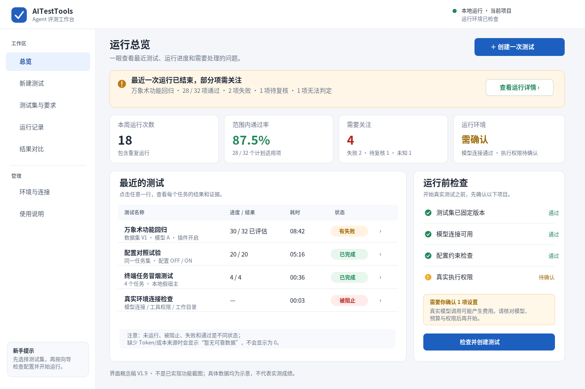
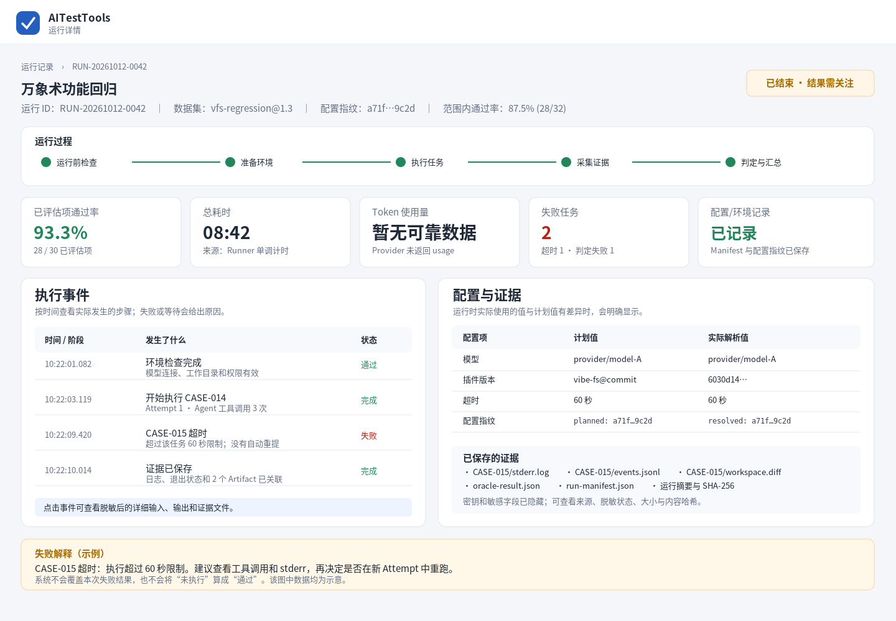
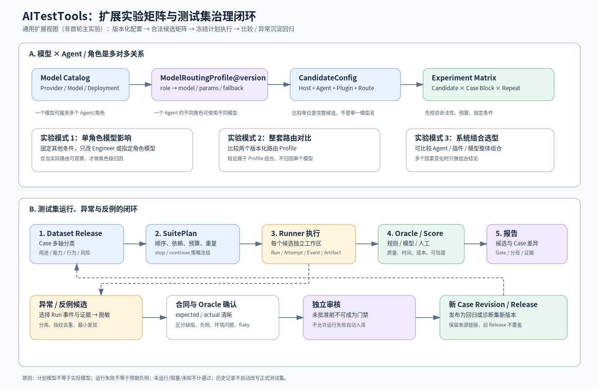
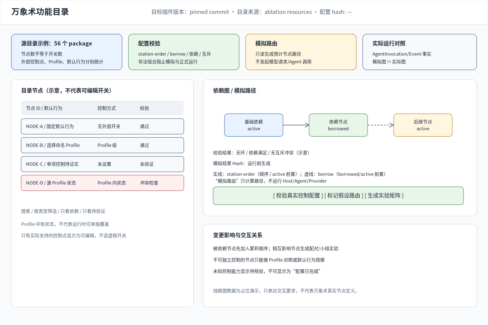
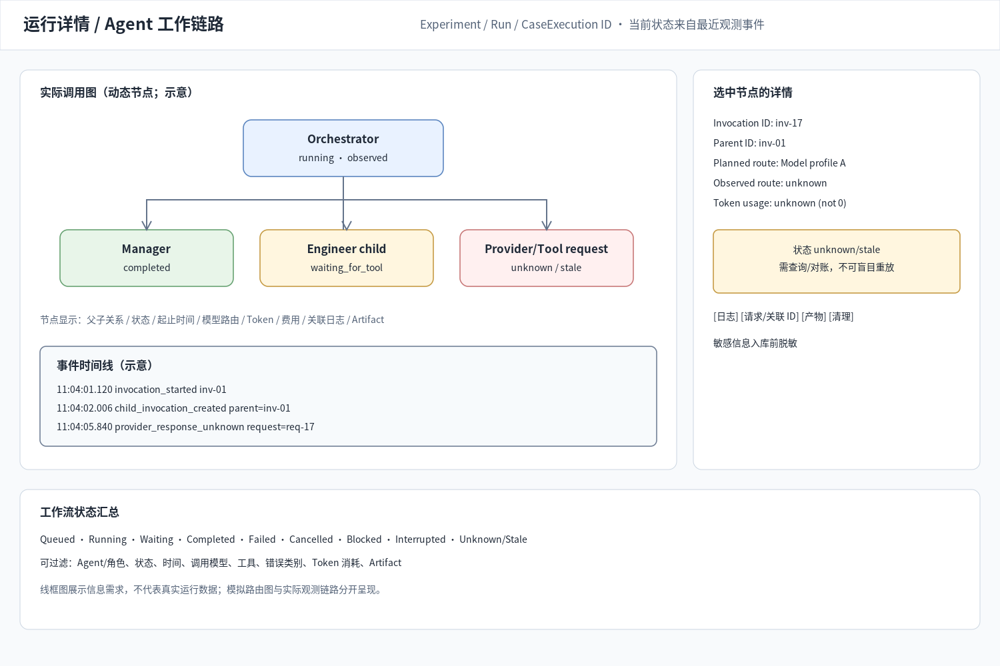
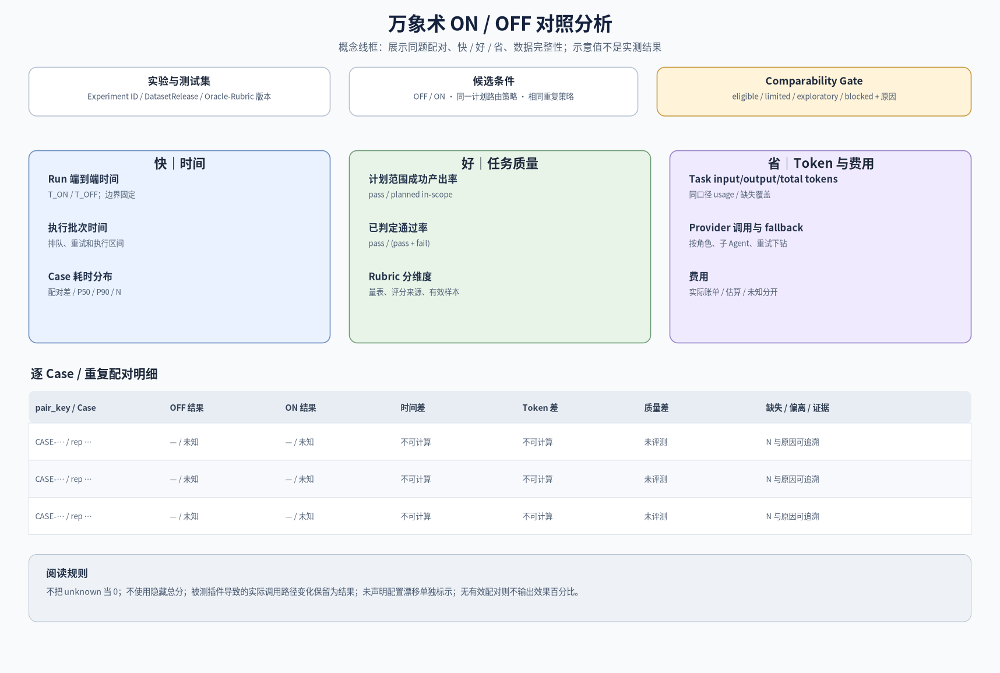

# AITestTools 界面与交互设计（V2.17）

**定位：** 本文件只定义用户能看到什么、能操作什么、操作后应如何反馈。对象状态和指标口径以 `02_总体架构与领域设计.md` 为准，产品能力以 `01_产品需求规格说明书.md` 为准。

## 1. 交互目标

界面面向不熟悉命令行、JSON 或 Agent 内部机制的测试人员。用户在任何一页都应能回答：**测什么、实际怎么运行、结果代表什么、依据在哪里、下一步该怎么办。**

首期产品形态是本机安装的可视化控制台，CLI/API 可用于批量自动化。界面不得用动画、假进度、配置标签或硬编码样例掩盖真实状态；未知数据要显示原因而不是空白或 0。

## 2. 导航结构

| 页面                  | 主要用途                                         | 最低信息                                                                           |
| --------------------- | ------------------------------------------------ | ---------------------------------------------------------------------------------- |
| 总览                  | 了解最近运行和待处理事项                         | 最近 Experiment/Run、完成/失败/阻塞数、待审核用例、环境状态、未解决功能目录差异    |
| 万象术功能与路由      | 查看功能目录、配置状态、依赖和模拟链路           | 所有源节点、状态模式、排序、依赖/互斥、校验结果、模拟路由与未支持项                |
| 用例与测试集          | 维护 Case、来源、Release 和异常候选              | 生命周期、自动化准备度、任务类型/难度、版本差异、预期/Oracle、来源 Run             |
| 实验设计              | 建立 ON/OFF、功能级、模型等级和任务分层矩阵      | 固定/变化因素、功能状态、依赖顺序、模型层、任务覆盖、预计工作量/预算               |
| 环境管理              | 一键创建、检查、重置、停止、销毁和重建环境       | Profile、实例状态、Git/依赖版本、数据种子、网络/隔离策略、清理记录                 |
| 运行详情与 Agent 链路 | 追踪真实运行过程和多 Agent 工作流                | Run/Case/Attempt/AgentInvocation 状态、父子调用图、日志、模型路由、Token、Artifact |
| 对比分析              | 查看 ON/OFF、功能消融和模型等级差异              | 快/好/省主指标、配对样本、分母、缺失、功能交互、协议偏离、可比性 Gate              |
| 模型与运行设置        | 配置 Provider、模型等级/资源池、预算、平台与隔离 | 能力来源、匹配理由、配置状态、限制值、OS 支持/验证状态；不展示密钥                 |
| 异常场景              | 设计、执行和复核受控故障情境                     | 注入阶段、触发方式、恢复策略、终态、日志/证据、重现种子                            |

首期不需要单独建设复杂帮助中心、任意仪表盘、远程多用户工作台或大屏编排器。功能目录、实验矩阵和 Agent 链路是本项目的核心专业可视化，不得被简化成只有统计卡片的普通仪表盘。术语可在页面旁通过简短说明解释，详细技术字段放入折叠区。

_线框图是结构草图，图中数据并非真实成绩，也不表示页面已经实现。_

## 3. 新建测试的四步流程

### 第一步：选择要测什么

用户选择实验设计类型：整体插件 ON/OFF、目标版本实际提供的命名 Profile 对照、经验证控制点上的单项消融、符合有效控制边界的依赖顺序累积或指定交互组合、默认行为场景观察；并选择已发布测试集、路线或实验模板。无单项控制入口的节点不得出现在可执行的单项消融选项中。显示数据集版本、Case 数量、任务类型×难度覆盖、用途、适用环境、正例/负例/边界覆盖和未覆盖项。草稿或候选用例不能无提示混入正式运行。

### 第二步：选择运行对象

选择 Host/Agent/插件固定版本、Provider/模型路由和版本化环境 Profile。功能相关实验还需选择 FeatureCatalogRelease，并选择目标版本真实支持的命名 Profile 或经验证的外部控制点；只有配置能被运行时实际接受时才做可执行模拟，否则标记为假设性模拟或默认行为观察。模型资源池按角色显示需求、匹配状态及原因；“匹配”不能替代连接验证。Secret 只能显示“已配置/不可用/未配置”，不能显示密钥内容。

### 第三步：确认运行设置

显示模型等级与实际模型、任务类型/难度分层、执行顺序/重复策略、每题/整批时限、请求/Token/费用上限、最大重试、并发、允许的文件/网络操作和故障注入 Profile（正常效果测试默认关闭故障注入）。高级选项可折叠，但任何影响安全或 ON/OFF 可比性的字段不能隐藏。预算/配额显示解析后的实际有限值和来源，不能显示“无限”或只有“很大”而不说明数值。

### 第四步：运行前检查

按数据集、Host/插件、Provider/模型、配置、权限/隔离、预算、指标采集和 Artifact 存储分组显示 `通过 / 警告 / 阻止 / 未检查`。每个阻断项要说明检查对象、发现的问题、影响范围和建议处理。用户确认后，Plan 冻结并启动 Run；运行启动后修改配置应创建新计划，而不是悄悄改变原任务。

## 4. 核心可视化工作台

### 4.1 用例维护与审核交互

用例列表支持按用途、能力、行为类型、风险、来源、生命周期和**自动化准备度**筛选。用例详情应并排展示：目标/输入、前提、步骤/动作、预期合同、Oracle/Rubric、所需证据、初始化/清理、权限/副作用、依赖、版本差异和来源。页面必须分别显示“用例是否正式审核/发布”和“是否已具备自动化设计条件”；不能用同一个状态表示二者。对缺少预期、Oracle、证据或清理步骤的用例，应提示缺项，而不是默认为可自动执行。

从失败 Run 创建候选时，系统自动带入源 Case、相关 Event/Artifact、实际输出与错误信息，并提醒先做脱敏。用户需明确选择异常类别，并填写预期行为、复现方法和 Oracle 方案。状态按 `draft → candidate → reviewed → validated → released → deprecated` 流转；“一键创建候选”不能等同于“直接发布正式回归测试”。发布后版本不可原地修改，需另建新版本并显示差异。审核信息应记录创建者、审核者和时间；首期为本机单用户信任模型时，系统记录的是流程声明，不应在没有独立账号/身份认证的前提下宣称已强制实现双人审批。

### 4.2 万象术功能目录与模拟路由

功能页把“目录”与“配置控制”显示为两个关联但不同的区域。目录从目标版本的 `nodes.json` 等资源导入，展示所有 package/slice 节点、定义、默认行为来源、关系、版本和可观测证据；顶部需分别统计源节点数、真实外部控制点数、可选择的命名 Profile、经验证的单独干预项、固定默认/仅观察项及映射差异。

配置区域只显示目标版本真实支持的入口，例如环境变量/配置字段的默认值与可选值，或 `WANXIANGSHU_ABLATION_PROFILE` 可选择的现有命名 Profile。不能因为节点在 `profiles.json` 中有 `active / borrowed / ablated` 状态，就为每个节点放一个自由编辑开关。节点详情显示控制类别、控制范围、默认值来源、如何验证已生效，以及本次实验可以归因到什么范围。没有独立控制点的节点显示“按当前版本默认行为运行/通过任务观察”，不是错误状态，也不是可点击开关。

只有经验证可以通过目标运行入口表达的候选配置才能生成“可执行模拟路由”；任意假设状态必须标记为“假设性模拟，不可直接运行”。图中区分 `station-order`、`borrow`、已证实硬依赖、冲突和交互关系。启动实验时冻结源目录、实际选用的命名 Profile/控制点值与模拟算法版本；运行后用实际事件切换到“实际链路”视图，不把模拟等同于实际行为。

### 4.3 功能级实验矩阵

矩阵按真实干预方式区分设计：

- **整体 ON/OFF：** 插件加载状态不同，其他约定条件固定。
- **已有 Profile 对照：** 选择目标版本真实支持的命名 Profile；结论归因到两组 Profile 的整体差异。
- **单项启用/消融：** 仅对存在经过验证的独立外部控制点的项目开放；否则禁用该设计并说明原因。
- **依赖顺序累积/交互组合：** 只有在每一步变化都能由受支持配置表达，并能核对实际生效时才属于正式干预实验。若只能改写随包资源或源码实现，必须单独标记为源辅助变体。
- **默认行为场景测试：** 对没有外部开关的包/功能，选取能覆盖相关能力域的任务，观察完成情况、产物、日志和成本。这属于覆盖与行为评测，不直接把差异归因到单个 package。

矩阵预览必须展示每组真正改变的控制点/Profile 差异、不可控因素、归因范围与证据要求。不得根据目录中的节点自动生成可编辑开关。

矩阵预览显示候选数、每个模型层的重复数、每类任务/难度覆盖、预计时间/调用/Token/费用、未覆盖节点和无法独立归因的组合。用户可以按风险、影响和先决关系筛选；不能在看过结果后临时改变矩阵而仍沿用同一实验 ID。

### 4.4 测试环境一键管理

环境卡片区分 Profile（可复用配方）与 Instance（一次实际环境）。用户可以一键建立、运行检查、重置、停止、销毁和基于同一 Profile 重建。执行前显示将安装/使用的 Host、插件、Node、依赖锁文件、工作区模板、测试数据种子、Provider 路由、网络与隔离设置；执行后显示真实版本、hash、资源状态和清理结果。实例状态包括准备中、就绪、运行中、清理中、已销毁、失败/脏状态。清理失败不能显示绿色“已完成”。

环境重建记录原 Profile 版本和新 EnvironmentManifest 差异；外部 Provider 或远端数据无法固定时明确标记为不可完全复现。环境管理界面还须显示测试平台 Git commit 和工作树状态，敏感值只显示 Secret Reference 状态。

## 5. 运行详情与证据下钻

运行详情的主区域提供 Agent/角色调用链图：

节点显示实际状态、父子关系、起止时间和最近观测时间；点击节点可查看该调用的日志、模型/Provider、工具调用、Token/费用、关联 Event 和 Artifact。链路图以真实 AgentInvocation/Event 为准；没有被 Host 观测到的状态显示 unknown/stale，不从计划路由推断。

运行详情还应将下列维度分开展示：

- **Run 生命周期：** 创建、预检、排队、执行、取消中、完成/失败/阻止等。
- **执行结果：** 单个 Case 是否真实运行、是否失败、超时、取消、未运行或被阻塞。
- **评测结果：** Oracle 判为通过/失败/无法判定，或尚未评测。
- **失败归因：** 产品、环境、Provider、数据、预期负例、随机波动或未知。归因不能覆盖实际结果。
- **执行与证据能力：** 哪些事实确实可观察、哪些未观测或不支持。

时间线记录 Preflight、准备环境、核验 Host/插件、任务执行、证据收集、评测和清理等真实事件。任务总数动态未知时不得显示伪造的百分比。取消/重试后必须等真实终态或清理结果，不以点击按钮成功代替实际取消。

从聚合指标可以下钻到 CaseExecution、Attempt、事件、Oracle/Rubric 与 Artifact。Artifact 显示类型、大小、hash、脱敏/读取状态和来源；缺失证据需要明确提示。

### 5.1 裁判触发与结果呈现

裁判三类来源在运行详情中分列呈现，不与硬门禁 `pass` 混合：

- **题目对比（确定性 oracle）**：必现，run 内自动执行，随运行详情直接展示。
- **模型判断（LLM-as-judge）**：run 完成后，在运行详情对单个 Case 或整次 Run 批量点击「触发裁判」，才调裁判模型逐维度判定。
- **人工判断（human）**：点击「人工复核」弹出表单，复用同一 `rubric.dimensions` 逐维勾选 `pass/fail` + 理由，可填 `human_reviewer`。

裁判结果以 `Score`（`source: 'deterministic_oracle' / 'model_judge' / 'human'`）逐维度展示为独立区块（如「裁判：维度A ✅ 维度B ❌」+ 理由），与「对不对」的硬门禁结果分开，一眼区分「做对了」和「做得好不好」。模型判断失败（模型不可用/超时/解析失败）显示 `judge_error`，不阻断、不影响 `pass`。

## 6. 对比分析界面

比较首页默认使用“快 / 好 / 省”三列并列展示，显示每项单位、公式入口、配对样本数量、统计范围和数据完整性。默认不使用未经批准的总分或冠军徽标。

- **快：** 展示整批目标任务耗时和逐 Case 耗时分布；把环境准备、评分、证据整理、清理等平台开销分开。
- **好：** 展示任务通过/失败/无法判定、质量维度和禁止副作用；评分规则版本与判定理由可追踪。
- **省：** 展示 Provider 输入/输出/总 Token、可核验费用、估算费用和未知项；按角色、回退路径和重试查看。

ON/OFF 条件不满足比较要求时，显示 `blocked` 或 `exploratory only`、原因和修正方向。可以查看两边原始结果，但不能展示正式“提高/降低 X%”或无条件排名。对比应支持按同一 Case/重复配对逐项查看 A/B 结果，而不只展示整体均值。固定的是计划路由策略；若被测插件导致实际子 Agent/角色调用路径发生变化，UI 应把它显示为观察到的行为及成本变化，而不是自动当作环境不一致。未声明的 Provider/模型漂移则单独显示协议偏离。

_该图仅表达指标与配对结果的展示结构；示意数字不代表实际评测结论。_

## 7. Provider、预算、平台和 Artifact 设置

模型/Provider 页面提供可维护的 Provider/Deployment 注册表与模型目录，可新增、导入、编辑、停用和执行连接/能力探测。页面展示连接器、模型标识、能力分类与证据、usage 观测能力、价格来源版本、Agent/角色匹配、fallback 链及状态。目录是可扩展配置，不要求内置完整供应商清单；未验证能力标 `未验证`，不根据名称自动变为兼容。

模型目录落地为 `models.json` 的界面化管理：列表页顶部按 `category` / `tags` / `status` 筛选；新增/编辑表单录入 `model_id`、`provider_id`、`category`、`tags`、`params`（参数档）、`api_key_env`、`status`。密钥只出现 `api_key_env` 引用名，界面提示「请在 .env 配置 `XXX=...`」，不提供明文输入框；删除或置 `inactive` 均可用。`category` 是单值主分类，`tags` 是多值自由筛选标签。

预算页允许选择/维护预算生成策略与 BudgetProfile，并显示系统建议、用户覆盖、解析后的时间、Provider 请求、Token、费用、重试、并发和资源限制及每项来源。超限时说明已消耗/未知消耗、是否停止、已尝试的安全恢复和需要人员执行的动作。

平台兼容页允许维护 Windows、macOS、Linux 的版本约束、架构范围、依赖版本规则、兼容状态与弃用规则；隔离页面维护已注册后端和 `IsolationProfile`，明确必需能力、探测结果与证据。新版本可添加为待验证组合，不能默认宣称已支持。Artifact 页支持人工删除、导入和导出；默认不自动到期，删除前显示历史引用影响，删除后有人工删除标记；容量由策略配置，实际限制和低磁盘风险始终可见。

## 7.1 受控异常场景设计与结果查看

异常场景页面按环境准备、插件加载、功能依赖/模拟路由、Agent/Provider、工具执行、证据采集、评分、持久化、取消/清理等阶段组织。每个场景显示故障类型、注入点、固定条件/随机种子、可重试性、预期终态、预期副作用、证据和清理要求。默认使用 Mock Provider、受控代理或隔离环境注入网络失败；不能把不可控公共网络故障作为稳定验收前提。

场景完成后对照预期与观察事实，突出是否产生重复副作用、是否正确显示 unknown/interrupted、预算是否有记录、Artifact/Manifest 是否封存、环境是否清理。故障用例本身也应是版本化 Case，可沉淀到回归 DatasetRelease。

## 8. 配置透明和安全交互

UI 区分计划值 `planned`、解析值 `resolved` 与实际观测值 `observed`。对模型身份、插件 ON/OFF、权限、数据版本、预算、安全隔离和计时等关键差异，必须在启动前阻断或要求明确确认。

本机 Console 默认只监听 loopback；状态变更请求要有基础 Origin/Host/CSRF 防护。页面不得显示原始密钥、完整环境变量、内部堆栈或无关绝对路径。错误信息提供稳定错误类别/关联 ID和可行动说明。

对于实际不能隔离的 OS 或运行方式，界面应显示“该安全能力未验证/真实执行受限”，不能仅用醒目绿色图标表示“安全”。

## 9. 首期 UI 验收场景

| 场景                          | 应看到的结果                                                              |
| ----------------------------- | ------------------------------------------------------------------------- |
| 新建一次合法运行              | 普通用户通过界面选择已发布测试集、配置、预检并启动，不必手写 JSON         |
| 插件 OFF 未被确认             | ON/OFF 比较被阻止，并说明缺少何种 Host 证据                               |
| Provider 不返回 usage         | Token/费用显示未知及原因，而不是 0                                        |
| 运行含失败、阻塞或未运行 Case | 每项均有独立状态与原因，不从分母中静默消失                                |
| 运行取消或超时                | 显示真实取消/清理状态；清理失败保持可见                                   |
| 有一条异常用于入库            | 可创建候选并引用证据，但未经审核不能正式发布                              |
| Artifact 到达配额             | 新写入/后续任务按明确策略停止并提示，已有产物不被静默删除                 |
| 可比性 Gate 未通过            | 显示差异字段和修正方向，不输出正式提升值/冠军                             |
| 功能配置有缺失依赖/循环       | 阻止模拟/运行并显示具体依赖路径，不生成“配置成功”结果                     |
| 功能配置通过并模拟路由        | 显示带版本/hash 的模拟节点顺序和预计调用链，不启动真实 Agent              |
| Agent 子调用状态未知          | 节点显示 unknown/stale 与最近事件，不伪装成运行中或完成                   |
| 一键环境重建                  | 生成新 EnvironmentManifest，显示版本/hash/种子差异和清理结果              |
| 请求提交后网络断开            | 先对账；副作用未知时不重复提交，Run 显示 unknown/interrupted 或需人工处理 |
| 56 项与源目录计数不一致       | 显示差异及未映射项，不宣称目录完整或允许误导性功能级归因                  |

UI 只消费公共应用服务的数据与状态契约，不自行发明业务结果。浏览器、CLI、报告和 JSON/CSV 导出需展示相同的状态、指标分母与证据引用。
